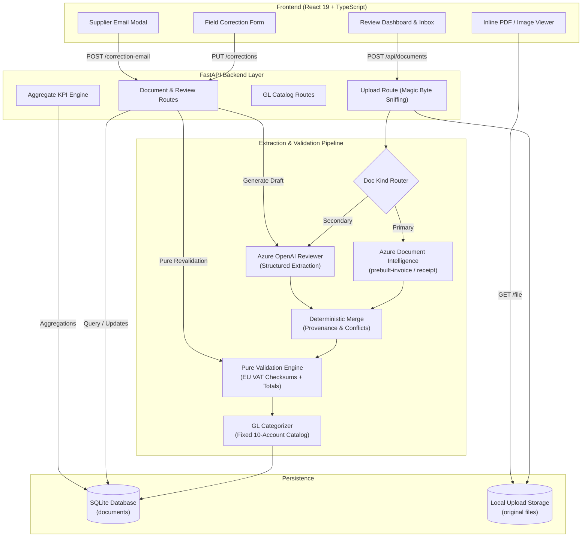

# Invoice Review

An AI-powered Financial Document Processing and Human-in-the-Loop (HITL) Audit System engineered for Northstar Facilities B.V. Combines Azure AI Document Intelligence, Azure OpenAI structured reasoning, pure deterministic European VAT validation, and a high-performance React interface.

[](https://www.python.org/)
[](https://fastapi.tiangolo.com/)
[](https://react.dev/)
[](https://www.typescriptlang.org/)
[](https://tailwindcss.com/)
[](https://www.sqlite.org/)
[](https://azure.microsoft.com/)
[](https://azure.microsoft.com/en-us/products/ai-services/openai-service)
[](https://github.com/astral-sh/ruff)
[](LICENSE)

---

## Table of Contents

- [Business Problem](#business-problem)
- [System Architecture](#system-architecture)
- [Architectural Principles & Boundaries](#architectural-principles--boundaries)
- [Key Features](#key-features)
- [Technology Stack](#technology-stack)
- [Directory Structure](#directory-structure)
- [Getting Started](#getting-started)
  - [Prerequisites](#prerequisites)
  - [Installation](#installation)
  - [Environment Configuration](#environment-configuration)
  - [Running the Application](#running-the-application)
- [API Reference](#api-reference)
- [Verification & Quality Assurance](#verification--quality-assurance)
  - [End-to-End System Verification](#end-to-end-system-verification)
  - [Corpus Evaluation](#corpus-evaluation)
  - [Hybrid Dual-Extraction Evaluation](#hybrid-dual-extraction-evaluation)
  - [Code Quality & Build Checks](#code-quality--build-checks)
- [Engineering Decisions](#engineering-decisions)
- [Security & Data Integrity](#security--data-integrity)

---

## Business Problem

Northstar Facilities B.V., a commercial property management firm based in Amsterdam, processes hundreds of multilingual contractor invoices and employee expense receipts each month across the Netherlands, Germany, Belgium, and France. 

Before this system:
1. **Manual Review Bottlenecks**: Finance operations spent 15+ hours weekly checking mandatory invoice headers, line-item totals, and tax breakdowns across diverse document layouts.
2. **Compliance & VAT Risks**: Invoices with invalid or malformed EU VAT numbers passed through unnoticed, creating tax exposure during audits.
3. **General Ledger Misclassification**: Manual coding into Northstar's 10-account General Ledger catalog led to inconsistent bookkeeping and reconciliation delays.
4. **Dispute Inefficiencies**: When vendor invoices contained errors, drafting correction requests required tedious cross-referencing and manual email drafting.

**The Solution**: An automated review pipeline that extracts structured financial data using a hybrid OCR/LLM architecture, verifies compliance against strict deterministic finance policies, recommends GL account codes from a fixed catalog, allows real-time human corrections with instant revalidation, drafts supplier dispute emails on demand, and presents aggregate financial KPIs in an intuitive web dashboard.

---

## System Architecture



---

## Architectural Principles & Boundaries

- **Strict Provider Isolation**: Azure SDK types and OpenAI SDK types never leak outside their respective provider adapters (`backend/app/providers/`). Clean, typed Pydantic models define domain boundaries across the service and API layers.
- **Pure Deterministic Validation**: Business logic in `backend/app/invoices/validation.py` is 100% deterministic, side-effect-free, and requires zero network access. Human reviewers can edit fields and revalidate instantly without incurring API latency or LLM costs.
- **Model Output Is Never Business Policy**: AI suggestions remain advisory. An LLM never unilaterally marks an invoice as approved or creates accounting entries; a human operator always reviews findings and records the final decision.
- **Field Provenance & Auditability**: Every document field tracks its source of truth: `primary` (Document Intelligence), `secondary` (Azure OpenAI fallback), or `user` (human operator override). Conflicting readings are explicitly surfaced with visual indicators.
- **Zero Hallucination General Ledger Coding**: Accounts are selected strictly from Northstar's approved 10-account catalog. The categorizer receives normalized financial fields (not raw unstructured tokens) and produces typed rationale with confidence scoring.

---

## Key Features

### 1. Hybrid Dual-Extraction with Field Provenance
- Runs primary extraction via Azure AI Document Intelligence (`prebuilt-invoice` and `prebuilt-receipt`).
- Runs secondary independent classification and structured extraction using Azure OpenAI Responses API with strict JSON schemas.
- Deterministically fills missing primary fields while preserving primary precedence and recording provenance (`primary`, `secondary`, `user`) and detected conflicts.

### 2. Pure Deterministic Compliance & VAT Validation
- **EU VAT Checksum Validation**: Implements offline ISO/IEC 7064 Mod 11, 10 structure and checksum checks via `python-stdnum` (supports NL, DE, BE, FR, etc.) with zero external API dependencies.
- **Customer Identity Verification**: Verifies customer entity matches Northstar Facilities B.V. (`NL00449544B01`).
- **Financial Reconciliation**: Validates that `subtotal + total_tax == invoice_total` within a strict EUR 0.01 tolerance.
- **Date Consistency**: Checks that `due_date >= invoice_date` and warns on past-due dates.
- **Duplicate Detection**: Flags identical vendor name and invoice number combinations across active reviews.

### 3. Fixed 10-Account General Ledger Categorization
- Automatically suggests one of Northstar's 10 standardized GL codes:
  - `6100` Cleaning services
  - `6110` Building maintenance
  - `6120` Electrical services
  - `6130` Plumbing & HVAC
  - `6140` Equipment & tools
  - `6150` Office supplies
  - `6160` Professional fees
  - `6170` Travel & transport
  - `6180` Utilities
  - `6190` Miscellaneous OPEX
- Reviewers can accept the AI recommendation or override it with 1 click.

### 4. Human-in-the-Loop Review & Real-Time Correction
- Reviewers can inspect side-by-side: original PDF/image preview on the left, structured findings on the right.
- Editable fields allow correcting OCR misreads; saving triggers instantaneous offline revalidation, immediately clearing errors and updating document status to `ready`.
- Documents with active validation errors cannot be approved (`409 Conflict` enforcement).

### 5. On-Demand Supplier Correction Email Drafting
- 1-click generation of supplier correspondence citing the exact invoice number, date, total, and detected validation discrepancies.
- Generated via Azure OpenAI structured output; rendered in a dedicated dialog with a copy-to-clipboard button.

### 6. Executive Financial KPI Dashboard & Inbox Filtering
- Real-time aggregate KPI metrics cards:
  - **Total Documents** processed
  - **Needs Review** backlog count
  - **Ready for Approval** count
  - **Total Approved Spend** formatted in EUR
- Live multi-attribute search across vendor name, invoice number, and filename.
- Accessible status filter tabs (`All`, `Needs Review`, `Ready`, `Approved`, `Rejected`).

---

## Technology Stack

| Layer | Technology | Purpose |
|---|---|---|
| **Backend Framework** | [FastAPI](https://fastapi.tiangolo.com/) (Python 3.12+) | High-performance async REST API with automatic OpenAPI specs |
| **Validation & Schemas** | [Pydantic v2](https://docs.pydantic.dev/) | Strict data contracts, JSON schema serialization, and validation |
| **Database ORM** | [SQLAlchemy 2.0](https://www.sqlalchemy.org/) | Type-safe database interactions and connection pooling |
| **Database Engine** | [SQLite](https://www.sqlite.org/) | Embedded relational storage requiring zero external services |
| **Package Manager (BE)** | [uv](https://github.com/astral-sh/uv) | Ultra-fast, reproducible Python environment and exact lockfile |
| **OCR / Document AI** | [Azure AI Document Intelligence](https://azure.microsoft.com/) | Specialized extraction models for invoices and receipts |
| **LLM Reasoning** | [Azure OpenAI Service](https://azure.microsoft.com/) | Structured extraction, GL categorization, and email drafting |
| **VAT Validation** | [python-stdnum](https://arthurdejong.org/python-stdnum/) | Offline EU VAT structure and checksum algorithms |
| **Frontend Framework** | [React 19](https://react.dev/) + [Vite 8](https://vitejs.dev/) | Reactive single-page application with hot module replacement |
| **Type Safety (FE)** | [TypeScript 5.9 Strict](https://www.typescriptlang.org/) | Comprehensive compile-time type verification |
| **Styling** | [Tailwind CSS 4.0](https://tailwindcss.com/) | Clean, accessible design system with responsive layouts |
| **Package Manager (FE)** | [pnpm 11](https://pnpm.io/) | Fast, deterministic disk-efficient frontend package manager |
| **Code Quality** | [Ruff](https://astral.sh/ruff) + [ESLint](https://eslint.org/) | Sub-millisecond Python linting and TypeScript code quality |

---

## Directory Structure

```
invoice-review/
├── backend/
│   ├── app/
│   │   ├── accounting/         # GL catalog, selection models, and API routes
│   │   ├── documents/          # Document models, repository, service, and routes
│   │   ├── invoices/           # Pure deterministic validation rules & VAT checks
│   │   ├── providers/          # Azure Document Intelligence & Azure OpenAI adapters
│   │   ├── schemas/            # Domain schemas (invoice, receipt, pipeline context)
│   │   ├── config.py           # Application settings and environment parsing
│   │   ├── database.py         # SQLAlchemy engine and session factory
│   │   ├── main.py             # FastAPI entrypoint, middleware, and SPA fallback
│   │   └── pipeline.py         # Modular pipeline step runner and context
│   ├── scripts/
│   │   ├── evaluate_corpus.py  # 13-document evaluation corpus runner
│   │   ├── evaluate_hybrid.py  # Hybrid extraction and conflict evaluator
│   │   └── verify_system.py    # Offline end-to-end system test runner
│   ├── pyproject.toml          # Exact pinned backend dependencies
│   └── uv.lock                 # Immutable lockfile
├── frontend/
│   ├── src/
│   │   ├── components/         # Review, Upload, Inbox, and UI components
│   │   ├── lib/                # Typed API client, environment, and TypeScript models
│   │   ├── App.tsx             # Root application orchestrator and state management
│   │   └── main.tsx            # React DOM mounting
│   ├── package.json            # Pinned frontend dependencies
│   └── pnpm-lock.yaml          # Immutable lockfile
├── samples/                    # 13 fictional multilingual test invoices & receipts
│   ├── generated/              # Sample PDFs and PNGs
│   └── manifest.json           # Expected evaluation targets and ground truth
├── scripts/
│   └── dev.ps1                 # Unified dev runner starting backend & frontend
└── docs/                       # Architecture specs and progressive build log
```

---

## Getting Started

### Prerequisites

- **Python**: 3.12 or newer
- **uv**: Python package and project manager (`pip install uv` or `cargo install uv`)
- **Node.js**: 22 or newer
- **pnpm**: 11 or newer (`corepack enable` or `npm install -g pnpm`)

### Installation

Clone the repository and install dependencies using the committed lockfiles:

```bash
# 1. Install backend dependencies into isolated virtual environment
cd backend
uv sync --locked

# 2. Install frontend dependencies
cd ../frontend
pnpm install --frozen-lockfile
```

### Environment Configuration

Configure environment variables for both backend and frontend:

**Backend (`backend/.env`):**
```bash
# Create local .env from template
cp backend/.env.example backend/.env
```

```ini
# Azure Document Intelligence
AZURE_DOCUMENT_INTELLIGENCE_ENDPOINT="https://<your-resource>.cognitiveservices.azure.com/"
AZURE_DOCUMENT_INTELLIGENCE_KEY="<your-api-key>"

# Azure OpenAI Service
AZURE_OPENAI_ENDPOINT="https://<your-resource>.openai.azure.com/"
AZURE_OPENAI_API_KEY="<your-api-key>"
AZURE_OPENAI_DEPLOYMENT_NAME="gpt-4o"
AZURE_OPENAI_API_VERSION="2024-10-21"

# Application Settings (Defaults)
DATABASE_URL="sqlite:///./data/invoices.db"
UPLOAD_DIR="./uploads"
MAX_UPLOAD_BYTES=4194304
ALLOWED_ORIGIN="http://localhost:5173"
EXPECTED_CUSTOMER_NAME="Northstar Facilities B.V."
EXPECTED_CUSTOMER_VAT_ID="NL00449544B01"
MIN_FIELD_CONFIDENCE=0.80
```

> [!NOTE]
> If live Azure cloud credentials are not supplied, offline system verification (`scripts/verify_system.py`) and UI testing run completely without network access.

**Frontend (`frontend/.env`):**
```bash
cp frontend/.env.example frontend/.env
```

```ini
VITE_API_BASE_URL="http://localhost:8000"
```

### Running the Application

Run both backend (:8000) and frontend (:5173) concurrently using the cross-platform development script:

```powershell
.\scripts\dev.ps1
```

Once running:
- **Web Interface**: [http://localhost:5173](http://localhost:5173)
- **API Swagger Documentation**: [http://localhost:8000/docs](http://localhost:8000/docs)
- **Health Check**: [http://localhost:8000/health](http://localhost:8000/health)

---

## API Reference

The FastAPI backend exposes the following RESTful endpoints:

| Method | Endpoint | Description |
|---|---|---|
| `GET` | `/health` | Service health status check |
| `POST` | `/api/documents` | Upload document (PDF/PNG/JPEG, max 4MB), execute review pipeline, store findings |
| `GET` | `/api/documents` | List documents with optional query filters (`status`, `search`, `limit`, `offset`) |
| `GET` | `/api/documents/stats` | Aggregate dashboard KPI metrics (counts by status, approved spend in EUR) |
| `GET` | `/api/documents/{id}` | Retrieve comprehensive document review details, line items, and issues |
| `GET` | `/api/documents/{id}/file` | Stream original uploaded file binary for inline browser viewing |
| `PUT` | `/api/documents/{id}/accounting` | Assign or override the Northstar General Ledger account code |
| `PUT` | `/api/documents/{id}/corrections` | Submit human field corrections and trigger pure deterministic revalidation |
| `POST` | `/api/documents/{id}/decision` | Record reviewer decision (`approved` or `rejected`) with state lock |
| `POST` | `/api/documents/{id}/correction-email` | Draft a contextual supplier dispute email via Azure OpenAI |
| `DELETE` | `/api/documents/{id}` | Permanently delete document record from SQLite and clean up disk storage |
| `GET` | `/api/accounting/gl-accounts` | List Northstar's fixed 10-account General Ledger catalog |

Interactive documentation, request payloads, and schema diagrams are available at `/docs`.

---

## Verification & Quality Assurance

In alignment with the project's quality guidelines, verification is proportional, demo-oriented, and reproducible without external unit testing harnesses:

### End-to-End System Verification

Execute the complete 8-stage offline system test runner in under 5 seconds:

```bash
cd backend
uv run --locked --no-sync python scripts/verify_system.py
```

**Verifies:**
1. Health check and 10-account General Ledger catalog retrieval.
2. File upload security (rejection of unsupported MIME types, empty payloads, and spoofed magic bytes).
3. Document persistence and retrieval with validation issues.
4. GL account code assignment and override tracking.
5. Reviewer field corrections with pure deterministic EU VAT and arithmetic revalidation.
6. Approval immutability and state machine conflict prevention (`409 Conflict`).
7. Real-time aggregate KPI metrics computation and search filtering.
8. Document deletion and binary file storage cleanup.

```
======================================================================
RESULT: 8/8 CHECKS PASSED (100%)
All architectural boundaries, schemas, and security checks verified!
======================================================================
```

### Corpus Evaluation

Evaluates the full 13-document multilingual evaluation corpus (`samples/`) against Document Intelligence and Northstar validation policies:

```bash
cd backend
uv run --locked --no-sync python scripts/evaluate_corpus.py
```

### Hybrid Dual-Extraction Evaluation

Evaluates hybrid extraction, verifying fallback behavior and conflict resolution between Document Intelligence and Azure OpenAI:

```bash
cd backend
uv run --locked --no-sync python scripts/evaluate_hybrid.py
```

### Code Quality & Build Checks

Ensure zero linter, compiler, or styling issues across both codebases:

```bash
# Backend code quality
cd backend
uv run --locked --no-sync ruff check app scripts ../playground

# Frontend type safety, linting, and production build
cd ../frontend
pnpm exec tsc -b --pretty false
pnpm lint
pnpm build
```

---

## Engineering Decisions

### 1. Why Hybrid Extraction (Document Intelligence + LLM)?
Azure Document Intelligence provides high-precision bounding boxes, table extraction, and multi-currency parsing. However, unstandardized receipts or poorly scanned invoices frequently omit critical fields (e.g., supplier tax identifiers). Azure OpenAI acts as a secondary reader, extracting missed metadata without overwriting primary readings, while tracking field provenance.

### 2. Why Pure Deterministic Validation?
Validation rules must produce deterministic, explainable outcomes for compliance and auditability. Relying on an LLM to decide whether an invoice is valid introduces hallucinations, non-deterministic decisions, and unnecessary API latency. Plain Python validation ensures that human corrections revalidate in under 1 millisecond.

### 3. Why SQLite with Clean Repository Architecture?
For single-tenant operational workflows and portfolio demonstrations, SQLite delivers zero-latency persistence without external database server overhead. The repository pattern (`DocumentRepository`) isolates all SQL queries, ensuring seamless portability to PostgreSQL or MySQL for cloud deployments.

---

## Security & Data Integrity

- **Binary Magic-Byte Inspection**: Prevents file extension spoofing by inspecting binary signatures (`%PDF`, `\x89PNG`, `\xff\xd8\xff`) directly from file bytes before passing to extraction services.
- **Path Traversal Protection**: Uploaded files and storage filenames are sanitized with `Path(filename).name`, strictly prohibiting directory traversal attacks.
- **Sanitized Data Corpus**: All sample invoices, merchant names, tax IDs, and addresses contain strictly fictional data.
- **Zero Live Scraping**: VAT structure validation is performed completely offline using check-digit mathematical algorithms, preventing external leakage of document identifiers.

---

## Author & Contact

Developed as an advanced AI engineering portfolio project demonstrating production full-stack development, LLM integration, and human-in-the-loop workflow architecture.

- **Developer**: Najeeb
- **Project Link**: [https://github.com/najee/invoice-review](https://github.com/najee/invoice-review)
- **Tutorial & Specification**: [Datalumina Invoice Review Tutorial](https://learn.datalumina.com/docs/invoice-review)
