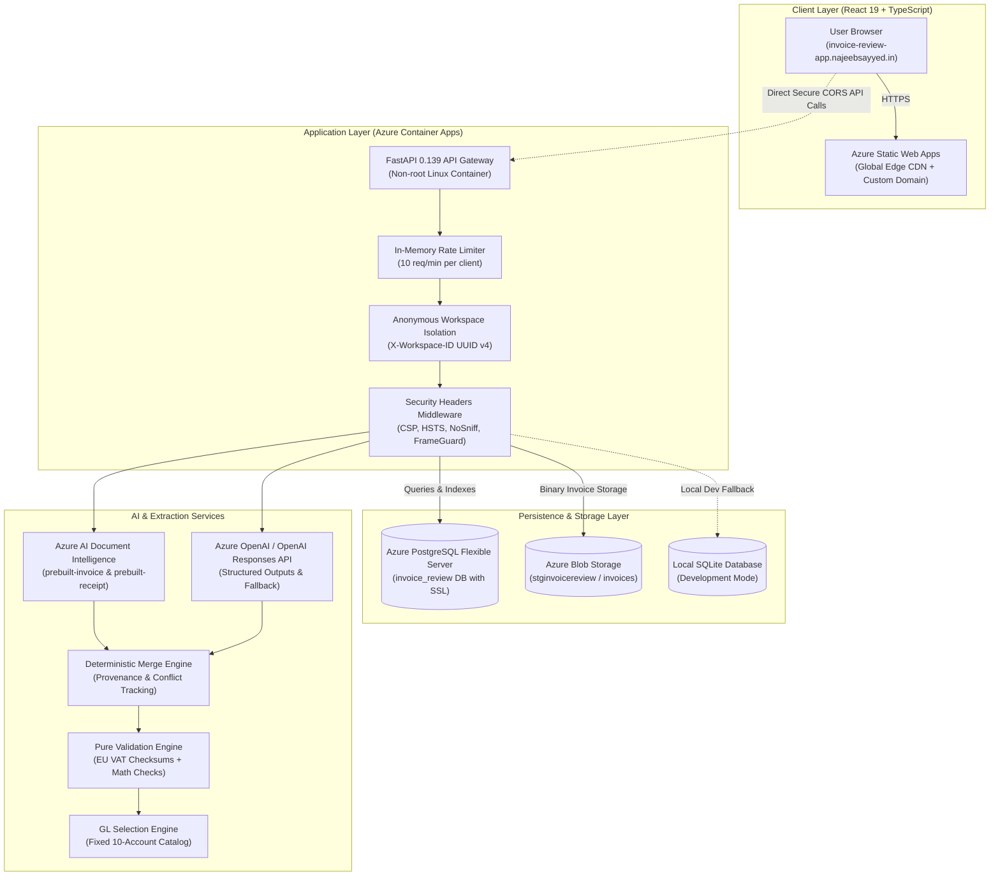

# Invoice Review — Production AI Financial Document System

An enterprise-grade, Human-in-the-Loop (HITL) Financial Document Processing and Accounting Coding Platform built for Northstar Facilities B.V. Combines Azure AI Document Intelligence, Azure OpenAI structured reasoning, pure deterministic European VAT validation, and a high-performance React interface deployed natively on Microsoft Azure.

🌐 **Live Production Application**: **[https://invoice-review-app.najeebsayyed.in/](https://invoice-review-app.najeebsayyed.in/)**  
🚀 **Live Backend API**: **[https://invoice-review-api.greenmushroom-2b5a71a4.centralindia.azurecontainerapps.io/health](https://invoice-review-api.greenmushroom-2b5a71a4.centralindia.azurecontainerapps.io/health)**

---

[](https://www.python.org/)
[](https://fastapi.tiangolo.com/)
[](https://react.dev/)
[](https://www.typescriptlang.org/)
[](https://tailwindcss.com/)
[](https://azure.microsoft.com/services/app-service/static/)
[](https://azure.microsoft.com/services/container-apps/)
[](https://azure.microsoft.com/services/postgresql/)
[](https://azure.microsoft.com/services/storage/blobs/)
[](https://azure.microsoft.com/services/ai-document-intelligence/)
[](https://platform.openai.com/)
[](https://github.com/astral-sh/ruff)
[](LICENSE)

---

## Table of Contents

- [Business Problem & Solution](#business-problem--solution)
- [System Architecture](#system-architecture)
- [Key Features](#key-features)
- [Technology Stack](#technology-stack)
- [Azure Cloud Infrastructure](#azure-cloud-infrastructure)
- [Directory Structure](#directory-structure)
- [Local Installation & Setup](#local-installation--setup)
  - [Prerequisites](#prerequisites)
  - [Backend Setup](#backend-setup)
  - [Frontend Setup](#frontend-setup)
  - [Environment Variables](#environment-variables)
  - [Running Locally](#running-locally)
- [API Reference](#api-reference)
- [Security & Production Hardening](#security--production-hardening)
- [Quality Assurance & Verification](#quality-assurance--verification)
- [Engineering Decisions](#engineering-decisions)
- [Known Limitations & Roadmap](#known-limitations--roadmap)
- [Author & Contact](#author--contact)

---

## Business Problem & Solution

Northstar Facilities B.V., a commercial property management firm based in Amsterdam, processes hundreds of contractor invoices and employee expense receipts each month across the Netherlands, Germany, Belgium, and France.

### The Challenges:
1. **Manual Review Bottlenecks**: Finance operations spent 15+ hours weekly manually checking mandatory invoice headers, line-item totals, and tax breakdowns across diverse document layouts.
2. **Compliance & VAT Risks**: Invoices with missing, invalid, or malformed European VAT numbers passed through unnoticed, creating severe tax exposure during audits.
3. **General Ledger Misclassification**: Manual coding into Northstar's 10-account General Ledger catalog led to inconsistent bookkeeping and reconciliation delays.
4. **Dispute Inefficiencies**: When vendor invoices contained errors or discrepancies, drafting dispute letters required tedious cross-referencing and manual email drafting.

### The Solution:
An automated, human-in-the-loop review pipeline that extracts structured financial data using a hybrid OCR/LLM architecture, verifies compliance against deterministic European finance policies, suggests General Ledger account codes from a fixed catalog with transparent reasoning, allows real-time human corrections with instant revalidation, drafts supplier dispute emails on demand, and presents aggregate financial KPIs in an intuitive dashboard.

---

## System Architecture



---

## Key Features

- **Dual-Model Hybrid Extraction**: Combines specialized layout OCR (Azure AI Document Intelligence) with generative LLM understanding (OpenAI Structured Outputs) to ensure resilient field extraction and zero lost data.
- **Pure Deterministic EU VAT Validation**: Validates VAT structure and check-digit algorithms across EU member states (via `python-stdnum`) entirely offline—no live external scraping, no hallucinations, and sub-millisecond execution.
- **Automated General Ledger Suggestion**: Analyzes item descriptions and supplier context to recommend one of Northstar's 10 standard General Ledger expense codes with a confidence score and explainable rationale.
- **Supplier Dispute Generator**: Automatically drafts polite, professional email requests to suppliers whenever mandatory fields (e.g., VAT ID, PO number, line item mismatch) fail validation checks.
- **Real-Time Human Corrections**: Allows reviewers to correct extracted amounts or vendor details inline with instant client-side policy recalculation.
- **Anonymous Device Workspace Isolation**: Multi-tenant data segregation achieved via client-generated UUIDs (`X-Workspace-ID`), ensuring complete privacy between devices without mandatory authentication friction.
- **Enterprise Cloud Security**: SSL-enforced database connections, encrypted Container App secret references, private blob containers, strict Content Security Policy, and non-root container sandboxing.

---

## Technology Stack

| Layer | Technology | Purpose |
| :--- | :--- | :--- |
| **Frontend** | React 19, TypeScript (Strict), Tailwind CSS 4, Vite 8 | High-performance responsive single-page application. |
| **Backend** | Python 3.12+, FastAPI, Pydantic v2, SQLAlchemy 2 | Type-safe REST API and business logic orchestration. |
| **Package Management** | `uv` (Python), `pnpm` (Node.js) | Fast, deterministic, lockfile-pinned dependencies. |
| **Cloud Hosting** | Azure Static Web Apps + Azure Container Apps | Serverless, consumption-based hosting with auto-scale to 0. |
| **Database** | Azure Database for PostgreSQL Flexible Server (16.15) | Production persistence; SQLite for local development. |
| **Document Storage** | Azure Blob Storage (Standard LRS) | Encrypted, persistent file storage for uploaded PDFs and images. |
| **AI Document Processing** | Azure AI Document Intelligence | Prebuilt invoice & receipt deep layout/table analysis. |
| **AI Reasoning & Coding** | OpenAI / Azure OpenAI | Strict structured JSON outputs, review fallback, and dispute emails. |
| **VAT Validation** | `python-stdnum` | Offline mathematical check-digit algorithms for EU VAT IDs. |

---

## Azure Cloud Infrastructure

The application runs on a cost-optimized, secure Microsoft Azure architecture:

```
┌────────────────────────────────────────────────────────────────────────┐
│                        Azure for Students                              │
├────────────────────────────────┬───────────────────────────────────────┤
│ Resource                       │ Configuration & Tier                  │
├────────────────────────────────┼───────────────────────────────────────┤
│ Azure Static Web Apps          │ Free Tier (Edge CDN, Custom Domain)   │
│ Custom Domain                  │ invoice-review-app.najeebsayyed.in    │
│ Azure Container Apps           │ Consumption Tier (0 to 1 Replicas)    │
│ Azure Container Registry       │ Basic SKU (acrinvoicereview.azurecr)  │
│ Azure Database for PostgreSQL  │ Burstable B1ms, 32 GiB, SSL Required  │
│ Azure Storage Account          │ Standard LRS, Public Access Disabled  │
│ Azure AI Document Intelligence │ F0 / S0 (koreacentral)                │
└────────────────────────────────┴───────────────────────────────────────┘
```

---

## Directory Structure

```
invoice-review/
├── .github/workflows/          # CI/CD deployment workflows (Azure Static Web Apps)
├── backend/
│   ├── app/
│   │   ├── accounting/         # 10-account GL catalog, selection validation & routes
│   │   ├── documents/          # Document model, SQLAlchemy repository, service, routes
│   │   ├── invoices/           # Pure deterministic VAT & financial validation rules
│   │   ├── pipeline/           # Hybrid extraction pipeline & classification
│   │   ├── schemas/            # Pydantic v2 domain schemas (invoice & receipt)
│   │   ├── services/           # Azure Document Intelligence & OpenAI adapters
│   │   ├── config.py           # Pydantic BaseSettings & CORS configuration
│   │   ├── database.py         # SQLAlchemy engine & dynamic driver fallback
│   │   ├── main.py             # FastAPI entry point, security middleware & health check
│   │   └── storage.py          # Storage abstraction (Azure Blob Storage & LocalFileStorage)
│   ├── scripts/
│   │   ├── deploy_containerapp.py  # Production Container App deployment automation
│   │   ├── evaluate_corpus.py      # 13-document test corpus evaluation
│   │   ├── evaluate_hybrid.py      # Dual-model conflict resolution evaluation
│   │   ├── setup_postgres.py       # Interactive PostgreSQL initialization & SSL check
│   │   └── verify_system.py        # End-to-end local & cloud system verification
│   ├── Dockerfile              # Hardened production non-root container image
│   └── pyproject.toml          # uv manifest with exact pinned dependencies
├── frontend/
│   ├── public/
│   │   └── staticwebapp.config.json # SWA routing, CSP & security headers
│   ├── src/
│   │   ├── components/         # React UI views (Inbox, Review, Upload, Preview)
│   │   ├── lib/
│   │   │   ├── api.ts          # Type-safe fetch client with X-Workspace-ID header
│   │   │   ├── env.ts          # Production API URL resolution
│   │   │   └── workspace.ts    # Anonymous persistent UUID generator
│   │   └── App.tsx             # Root React application component
│   ├── package.json            # pnpm configuration with React 19 & Tailwind 4
│   └── vite.config.ts          # Vite build config with sourcemaps disabled
├── samples/                    # Multilingual fictional test corpus (13 documents)
├── AZURE_DEPLOYMENT.md         # Comprehensive cloud setup & operations guide
└── README.md                   # This documentation
```

---

## Local Installation & Setup

### Prerequisites

- **Python 3.12+** and [**uv**](https://docs.astral.sh/uv/) (`pip install uv` or `winget install astral-sh.uv`)
- **Node.js 22+** and [**pnpm**](https://pnpm.io/) (`npm install -g pnpm`)
- Azure Document Intelligence & OpenAI API keys (or run in offline evaluation mode)

### 1. Clone the Repository

```bash
git clone https://github.com/najeebsayyed/invoice-review-application.git
cd invoice-review-application
```

### 2. Backend Setup

```bash
cd backend

# Create virtual environment and synchronize locked dependencies
uv sync --locked

# Create your local environment file
copy .env.example .env
```

### 3. Frontend Setup

```bash
cd ../frontend

# Install locked dependencies
pnpm install --frozen-lockfile

# Create local frontend environment file
copy .env.example .env
```

### 4. Environment Variables

Configure your `backend/.env` file with your credentials (placeholders shown below):

```env
# -----------------------------------------------------------------------------
# Database Configuration
# Leave commented out for zero-config local SQLite (backend/data/documents.db)
# -----------------------------------------------------------------------------
# DATABASE_URL=postgresql+psycopg://<username>:<password>@invoice-review-db.postgres.database.azure.com:5432/invoice_review?sslmode=require

# -----------------------------------------------------------------------------
# Azure Blob Storage (Optional: defaults to local backend/data/uploads)
# -----------------------------------------------------------------------------
# AZURE_STORAGE_CONNECTION_STRING=DefaultEndpointsProtocol=https;AccountName=<account>;AccountKey=<key>;EndpointSuffix=core.windows.net
# AZURE_STORAGE_CONTAINER_NAME=invoices

# -----------------------------------------------------------------------------
# CORS Allowed Origins
# -----------------------------------------------------------------------------
ALLOWED_ORIGINS=http://localhost:5173,http://localhost:4173,https://invoice-review-app.najeebsayyed.in

# -----------------------------------------------------------------------------
# AI Services Configuration
# -----------------------------------------------------------------------------
AZURE_DOCUMENT_INTELLIGENCE_ENDPOINT=https://<your-resource>.cognitiveservices.azure.com/
AZURE_DOCUMENT_INTELLIGENCE_KEY=<your-document-intelligence-key>

OPENAI_API_KEY=<your-openai-api-key>
OPENAI_MODEL=gpt-5.6-terra
```

### 5. Running Locally

**Terminal 1 — Backend:**
```powershell
cd backend
uv run --locked --no-sync python -m uvicorn app.main:app --reload --host 127.0.0.1 --port 8000
```

**Terminal 2 — Frontend:**
```powershell
cd frontend
pnpm dev
```

Open [http://localhost:5173](http://localhost:5173) in your browser.

---

## API Reference

All document routes enforce device isolation using the `X-Workspace-ID: <UUID>` request header.

| Method | Endpoint | Description |
| :--- | :--- | :--- |
| `GET` | `/health` | Health-check endpoint returning `{"status":"ok"}`. |
| `GET` | `/api/accounting/gl-accounts` | Returns all 10 standard General Ledger accounts with descriptions. |
| `GET` | `/api/documents/stats` | Retrieves aggregate dashboard metrics (spend, counts, approvals). |
| `GET` | `/api/documents` | Lists documents scoped to workspace with status and search filters. |
| `POST` | `/api/documents` | Uploads document (PDF/PNG/JPEG), triggers pipeline, and returns review. |
| `GET` | `/api/documents/{id}` | Retrieves full extraction and policy review details for a document. |
| `GET` | `/api/documents/{id}/file` | Streams original binary document file (inline Content-Disposition). |
| `PUT` | `/api/documents/{id}/accounting` | Overrides or confirms the General Ledger account code. |
| `POST` | `/api/documents/{id}/decision` | Records reviewer decision (`APPROVED` or `REJECTED`). |
| `PUT` | `/api/documents/{id}/corrections` | Applies manual field edits and triggers instant policy revalidation. |
| `POST` | `/api/documents/{id}/correction-email` | Generates a drafted dispute letter to the supplier. |
| `DELETE` | `/api/documents/{id}` | Permanently deletes document record and associated binary file. |

---

## Security & Production Hardening

The application was built following strict enterprise security standards:

1. **Zero Secret Leakage**:
   - Comprehensive automated scans across full Git history and build bundles verified that zero credentials, API keys, or connection strings were ever committed.
   - All production secrets (`DATABASE_URL`, `AZURE_STORAGE_CONNECTION_STRING`, `OPENAI_API_KEY`, `AZURE_DOCUMENT_INTELLIGENCE_KEY`) are stored in Azure Container Apps encrypted vaults and referenced via `secretRef`.
2. **Database Security & Network Isolation**:
   - Azure PostgreSQL Flexible Server strictly enforces `require_secure_transport = on` (SSL/TLS encrypted transport).
   - Firewall rules are locked to Azure internal service infrastructure (`0.0.0.0`) and the administrator's specific management subnet; wide-open public access (`0.0.0.0/0`) is strictly prohibited.
3. **Private Blob Storage**:
   - Azure Storage Account has `allowBlobPublicAccess = false`. Document containers cannot be read anonymously over the public web; access is mediated entirely through the authenticated backend API.
4. **Non-Root Container Hardening**:
   - Production Docker images configure and execute under a non-root service account (`USER appuser`, UID `10001`), minimizing container breakout risks.
5. **Abuse & Cost Protection**:
   - Implemented an in-memory sliding window rate limiter on `POST /api/documents` (10 uploads/minute per client) to prevent automated cost exhaustion on AI endpoints.
6. **Binary Signature Verification**:
   - File uploads are inspected for valid magic bytes (`%PDF`, `\x89PNG`, `\xff\xd8\xff`) to prevent MIME-type spoofing and malicious executable uploads.
7. **Production Security Headers**:
   - Both Azure Static Web Apps and FastAPI inject strict HTTP security headers:
     - `Content-Security-Policy`: Restricts script, style, image, and network connect sources.
     - `Strict-Transport-Security`: Enforces HTTPS (`max-age=31536000; includeSubDomains; preload`).
     - `X-Content-Type-Options: nosniff`
     - `X-Frame-Options: DENY`
     - `Referrer-Policy: strict-origin-when-cross-origin`
     - `Permissions-Policy`: Restricts camera, microphone, geolocation, and payment hardware.
8. **Information Disclosure Prevention**:
   - Interactive Swagger/OpenAPI documentation is disabled by default in production (`enable_api_docs = False`).
   - Server identification headers (`Server: uvicorn`) are stripped from HTTP responses.
   - Unhandled internal exceptions log full tracebacks to private logs while returning sanitized, generic messages to clients.

---

## Quality Assurance & Verification

The codebase includes multiple verification suites to guarantee compliance and correctness:

### 1. End-to-End System Verification
Verifies the complete lifecycle (upload, OCR, AI coding, correction, approval immutability, KPI aggregation, deletion):
```bash
cd backend
uv run --locked --no-sync python scripts/verify_system.py
```

### 2. Multilingual Corpus Evaluation
Runs the 13-document multilingual evaluation corpus (`samples/generated/`) through Document Intelligence and Northstar validation policies:
```bash
cd backend
uv run --locked --no-sync python scripts/evaluate_corpus.py
```

### 3. Static Analysis & Build Verification
```bash
# Backend linting & type checks
cd backend
uv run --locked --no-sync python -m ruff check .

# Frontend strict type checking & linting
cd ../frontend
pnpm exec tsc -b
pnpm run lint

# Production build verification
pnpm run build
```

---

## Engineering Decisions

1. **Why Hybrid Extraction (OCR + Generative LLM)?**  
   Azure Document Intelligence delivers high-precision bounding boxes, table structures, and currency parsing. However, real-world contractor invoices frequently format tax IDs in non-standard headers. The OpenAI model acts as a secondary reader to capture missed fields without overwriting primary readings, tracking provenance for every field.

2. **Why Pure Deterministic Validation?**  
   Compliance checks must produce 100% predictable, auditable, explainable outcomes. Relying on an LLM to decide whether an invoice is valid introduces hallucinations and non-deterministic audit trails. Pure Python logic ensures sub-millisecond execution and reliable accounting.

3. **Why Anonymous Workspace UUIDs instead of Traditional Auth?**  
   For open portfolio evaluation and public testing, requiring user registration causes drop-off. By generating and persisting a cryptographically random UUID v4 in browser storage (`localStorage`), every visitor experiences isolated state, personal KPI metrics, and complete data segregation.

---

## Known Limitations & Roadmap

- **VIES Live Verification**: VAT validation currently validates mathematical checksums and structural country codes locally; live European Commission VIES API registration lookup is planned for a future release.
- **Enterprise RBAC**: While workspaces provide isolation, full enterprise multi-user role-based access control (Admin, Approver, Auditor) can be integrated via Azure Entra ID / OAuth2.
- **Webhook Ingestion**: Currently accepts user uploads via web UI; future versions will support automated email inbox ingestion via Azure Logic Apps.

---

## Author & Contact

**Najeeb Sayyed**  
- **Portfolio & Custom Domain**: [https://invoice-review-app.najeebsayyed.in](https://invoice-review-app.najeebsayyed.in)  
- **GitHub**: [@najeebsayyed](https://github.com/najeebsayyed)  
- **LinkedIn**: [Najeeb Sayyed](https://linkedin.com/in/najeebsayyed)
